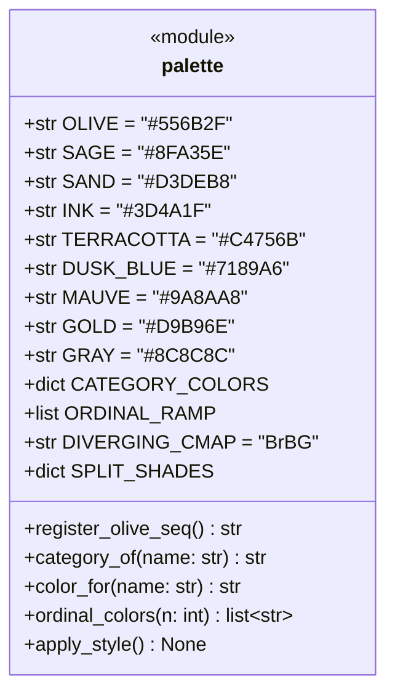
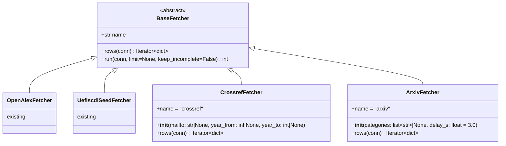
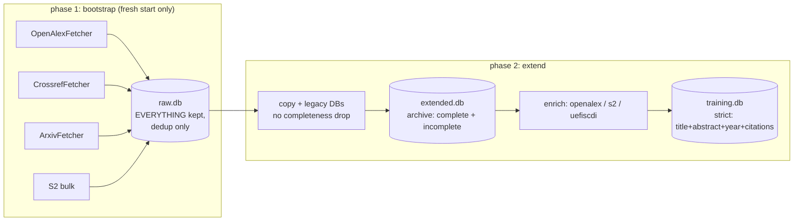
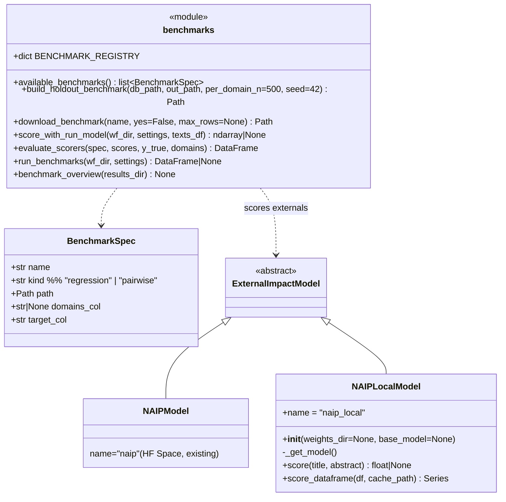
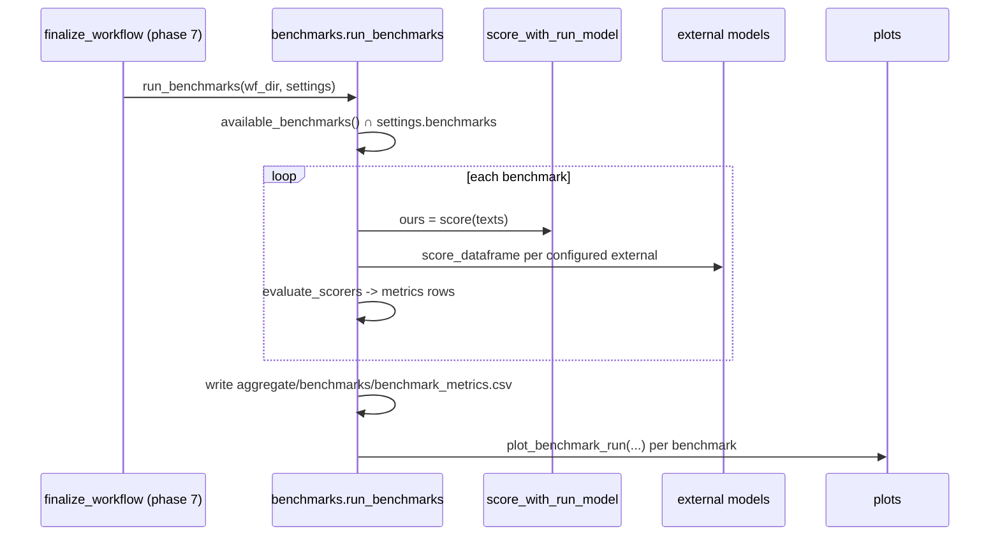

# PLAN — Benchmarks, External Models, Plot Redesign, Dataset Analysis, Scraper Restructure

**Execution model: ONE Haiku agent, strictly SEQUENTIAL.** Work Stage 1 → Stage 7.
Never start a stage before the previous CHECKPOINT is green. One stage = one commit.
If blocked (missing package, ambiguous schema, failing check): STOP inside the stage
and report — do not improvise and do not skip ahead.

> **HARD CONSTRAINTS (re-read before every stage)**
> 1. NO `pip install` or any package-manager command. Missing package ⇒ STOP + report.
> 2. Never run training or network scripts yourself; hand the user the command.
>    Pure-python import checks / `ast.parse` are allowed.
> 3. `epai/` is READ-ONLY (import from it, never edit).
> 4. ALL figure-drawing code lives in `workflow/src/iwf/evaluation/plots.py`
>    (or existing evaluation modules). ALL metric math lives in
>    `workflow/src/iwf/evaluation/metrics.py`. No copies elsewhere.
> 5. Results contract: per-run artifacts → `results/<wf>_N/…`; cross-run artifacts →
>    `results/summary/`.
> 6. Parameters travel via `Settings` overrides — never `os.environ`.
> 7. Use ONLY the verified APIs in §X below. If a needed symbol is not listed there,
>    READ the source file first; never guess a signature.

---

# §R Research grounding (done — do not redo)

## R1. Benchmarks (title+abstract → impact)

| name (registry id) | kind | size / domains | source | metric protocol |
|---|---|---|---|---|
| `naip12k` | regression (TNCSI_SP target) | >12k papers | GitHub `ssocean/NAIP` (AAAI'25, arXiv 2408.03934) | Spearman, NDCG@10%, MAE |
| `sciimpact_pairs` | pairwise | 215,928 pairs, 19 fields | homepage `flypig23.github.io/sciimpact-homepage` (arXiv 2604.17141) | pairwise accuracy |
| `acl_bibliometry` | regression (log citations) | ~30k, NLP | linked from SChuBERT repo (arXiv 2012.11740) | R², Spearman |
| `dblp_v14_sample` | regression (recompute our target) | subsample of 4.1M CS | aminer.org/citation (~17 GB, STREAM+SUBSAMPLE only) | Spearman, NDCG@10% |
| `holdout_extended` | regression (our `field_year_percentile`) | ~24k local, multi-domain | built locally from extended.db | all metrics |

## R2. External (outsider) models — comparison targets

Already implemented in `features/external_impact.py` registry: `naip` (HF Space,
network), `specter2_knn`, `llm_judge`, `venue_ais`, `forecite`, `cited_potential`.
Stage 5 adds `naip_local` (LoRA weights from `ssocean/NAIP`).

## R3. Package-approval matrix

| package | needed by | status |
|---|---|---|
| `peft` | Stage 5 `naip_local` only | check `.venv/Scripts/python.exe -c "import peft"`; if missing: degrade + report |
| everything else (torch, transformers, sklearn, matplotlib, plotly, pandas, requests, tqdm, gradio_client, joblib) | — | already installed; verify by import at stage start |

---

# §X VERIFIED EXISTING API (use these symbols verbatim — do NOT reinvent)

### X1. `workflow.src.iwf.paths`
```python
REPO_ROOT, WORKFLOW_DIR, DATA_DIR, PARQUET_DIR, SQL_DIR, CACHE_DIR,
RESULTS_DIR, MODELS_DIR: Path
raw_parquet(dataset_id) / prepared_parquet(...) / embedded_parquet(...)
reduced_parquet(...) / encoder_path(...) / encoder_meta_path(...) -> Path
ensure_dirs() -> None
```

### X2. `workflow.src.iwf.config`
```python
WORKFLOWS: dict[str, dict]   # keys: emb_clf, emb_reg, emb_meta_clf, emb_meta_reg,
                             # emb_all_meta_clf, emb_all_meta_reg, tfm_clf, tfm_reg
                             # values: {"task": "clf"|"reg", "features": "z"|"meta"|"all_meta"|"text", "phases": [...]}
get_str(key, default) -> str; get_int(key, default) -> int
get_bool(key, default) -> bool; secret(key) -> str | None
load_config_yaml(path=None) -> dict
load_settings(path=None, overrides=None) -> Settings
is_text_workflow(wf) -> bool
@dataclass Settings  # relevant existing fields:
    dataset_id: str; target_kind: str; target_min_refset: int
    class_thresholds: list[float]; class_names: list[str]
    embedders: list[str]; embed_for_encoder: str
    external_impact: list[str]        # ← copy this declaration style for new fields
    metadata_fields: list[str]; workflow_type: str
    # Settings.update(overrides: dict) coerces types via dataclass fields
```

### X3. `workflow.src.iwf.data.identity`
```python
PAPER_ID = "paper_id"
normalize_doi(doi: str | None) -> str | None
stable_text_id(title, abstract, salt="") -> str
ensure_paper_id(df) -> pd.DataFrame
```

### X4. `workflow.src.iwf.fetchers.base`  (THE row contract for Stage 4)
```python
NORMALIZED_KEYS = ("paper_id","doi","title","abstract","year","venue","venue_issn",
  "citation_count","influential_citation_count","fwci",
  "citation_normalized_percentile","is_in_top_1_percent","is_in_top_10_percent",
  "domains","subfield","authors","source","venue_ais","venue_zone","oa_id")
# authors value = list[dict] with keys author_id, name, h_index, citation_count, paper_count
extended_db_path() -> Path                      # paths.SQL_DIR / "extended.db"
open_db(path=None) -> sqlite3.Connection        # creates schema (papers/authors/paper_authors/fetch_state)
class Deduper:                                  # dedup on paper_id, DOI, (title,year) hash
    __init__(conn); seen(row: dict) -> bool; add(row: dict) -> None
insert_paper(conn, row: dict) -> None           # INSERT OR IGNORE, no commit
get_cursor(conn, source) -> str | None
set_cursor(conn, source, cursor, fetched) -> None
class BaseFetcher(ABC):
    name: str
    rows(self, conn) -> Iterator[dict]          # ABSTRACT — yield normalized dicts
    run(self, conn, limit=None) -> int          # dedups, inserts, commits every 500
    # NOTE run() line ~226 currently SKIPS rows without abstract — Stage 4 makes
    # that skip conditional (keep_incomplete flag).
```

### X5. `workflow.src.iwf.evaluation.metrics`
```python
regression_metrics(y_true, y_pred) -> dict
classification_metrics(...) -> dict
```

### X6. Frozen-model scoring path (mirror of `src/main_predict_generated.py`)
```python
from workflow.src.iwf.encoder.base import load_saved_encoder
from workflow.src.iwf.embedding.embedders import embed_dataframe, emb_matrix
enc, meta = load_saved_encoder(settings.dataset_id)      # meta["embed_for_encoder"]
df = embed_dataframe(df, [meta["embed_for_encoder"]])    # adds emb column
X  = emb_matrix(df, meta["embed_for_encoder"])           # np.ndarray [n, d]
Z  = enc.transform(X)                                    # reduced features
model  = joblib.load(wf_dir/"seed_i"/"model"/"model.joblib")
scaler = joblib.load(wf_dir/"seed_i"/"model"/"scaler.joblib")
y = model.predict(scaler.transform(Z))
```

### X7. `workflow.src.iwf.workflow_results`
```python
PRIMARY_METRIC = {"reg": "spearman", "clf": "macro_f1"}
task_of(wf_type) -> str
seed_results(wf_dir) -> list[dict]      # each seed's result.json + _seed_dir/_seed_name
aggregate(wf_type, wf_dir, settings) -> dict | None
finalize_workflow(wf_type, settings, wf_dir) -> dict | None   # phase 7 entry (line ~368)
cross_workflow_comparison() -> dict
```

### X8. `workflow.src.iwf.evaluation.baseline_compare`
```python
_best_seed_test_preds(wf_dir) -> tuple[y_true, y_pred] | None   # test split, best seed
baseline_metrics(y_true, scores_by_scorer: dict[str, np.ndarray], thresholds) -> pd.DataFrame
generate_baseline_plots(wf_type, task, wf_dir, settings) -> None
baseline_leaderboard(results_dir) -> None    # writes results/summary/baseline_leaderboard.png
```

### X9. `workflow.src.iwf.features.external_impact`
```python
class ExternalImpactModel(ABC):
    name: str
    score(self, title: str, abstract: str) -> float | None      # ABSTRACT
    score_dataframe(self, df, cache_path) -> pd.Series          # cached by paper_id
_REGISTRY: dict[str, type]   # naip, specter2_knn, llm_judge, venue_ais, forecite, cited_potential
known_external_models() -> list[str]
get_external_models(names) -> list[ExternalImpactModel]
```

### X10. `workflow.src.iwf.evaluation.plots` internals to reuse
```python
_get_domain(df) -> pd.Series            # domain per row (line 113)
_load_best_seed_data(wf_dir, task) -> dict | None
generate_workflow_plots(wf_type, task, wf_dir, settings) -> None
```

---

# STAGE 1 — palette.py + full restyle

**Files:** NEW `workflow/src/iwf/evaluation/palette.py`; EDIT `plots.py`,
`baseline_compare.py`, `nf_analysis.py`, `workflow_results.py`,
`workflow/src/main_extend_db.py`. NOTHING else.

## 1.1 Module spec — `palette.py`



```python
CATEGORY_COLORS = {
    "emb_clf": OLIVE, "emb_reg": SAGE,
    "tfm_clf": DUSK_BLUE, "tfm_reg": "#93A9C4",
    "meta": GOLD,          # every emb_meta_* / emb_all_meta_* workflow
    "external": TERRACOTTA,  # downloaded/outsider scorers
    "target": GRAY,
}
ORDINAL_RAMP = [SAND, "#B9C98F", SAGE, "#6E8440", OLIVE, INK]   # low→high impact
SPLIT_SHADES = {"train": OLIVE, "val": SAGE, "test": SAND}
```

**`register_olive_seq() -> str`** — build
`matplotlib.colors.LinearSegmentedColormap.from_list("olive_seq", [SAND, OLIVE, INK])`,
register with `matplotlib.colormaps.register(...)` inside
`if "olive_seq" not in matplotlib.colormaps:` (idempotent), return `"olive_seq"`.

**`category_of(name: str) -> str`** — EXACT algorithm, in this order:
1. `n = str(name).strip().lower()`
2. if `n == "target"` → `"target"`
3. if `n == "ours"` → `"ours"` is NOT resolvable here — return `"external"`?? NO:
   callers must pass the run/folder name for "ours"; if literally `"ours"` arrives
   return `GRAY`-category `"target"`. (Rule: `"ours" -> "target"`.)
4. if `n` in `{"naip","naip_local","specter2_knn","llm_judge","venue_ais",
   "forecite","cited_potential"}` (hardcode this frozenset — do NOT import
   external_impact, that would create an import cycle) → `"external"`
5. strip one trailing `_<digits>` group: `base = re.sub(r"_\d+$", "", n)`
6. if `base.startswith("emb_meta") or base.startswith("emb_all_meta")` → `"meta"`
7. if `base in CATEGORY_COLORS` → `base`   (covers emb_clf/emb_reg/tfm_clf/tfm_reg)
8. else → `"external"`

**`color_for(name) -> str`** = `CATEGORY_COLORS.get(category_of(name), GRAY)`.

**`ordinal_colors(n: int) -> list[str]`** — if `n <= len(ORDINAL_RAMP)`: indices
`np.linspace(0, len(ORDINAL_RAMP)-1, n).round().astype(int)` into ORDINAL_RAMP;
else interpolate through `LinearSegmentedColormap.from_list("_tmp", ORDINAL_RAMP)`
and return hex via `matplotlib.colors.to_hex`.

**`apply_style() -> None`** — exactly:
```python
matplotlib.rcParams.update({
    "axes.spines.top": False, "axes.spines.right": False,
    "axes.grid": True, "grid.alpha": 0.3,
    "figure.facecolor": "white", "axes.facecolor": "white",
    "font.size": 10, "axes.titlesize": 12, "axes.labelsize": 10,
    "legend.frameon": False,
})
```

## 1.2 Replacement table (every site; grep-verified line numbers)

| file:line | old | new |
|---|---|---|
| plots.py:39 | `_ORDINAL_PALETTE = ["#d62728",…]` | delete; use `palette.ordinal_colors(n)` at call sites (`_ordinal_color(idx,total)` at line 67 wraps it) |
| plots.py:43 | `CORRECT_COLOR = "#E8B923"` | `palette.GOLD` |
| plots.py:44 | `WRONG_COLOR = "#8E44AD"` | `palette.MAUVE` |
| plots.py:45 | `ERROR_COLORSCALE = [[0,"#F2C744"],[1,"#8E44AD"]]` | `[[0, palette.GOLD],[1, palette.MAUVE]]` |
| plots.py:49 | local `SPLIT_SHADES` | `from …palette import SPLIT_SHADES` |
| plots.py:212,214,257,259 | `#8FA35E` default / `#3d4a1f` edges | `palette.SAGE` / `palette.INK` |
| plots.py:287–296 | `tab:blue`, `tab:green` | `palette.DUSK_BLUE`, `palette.OLIVE` |
| plots.py:316 | `cmap="Blues"` | `cmap=palette.register_olive_seq()` |
| plots.py:341–342 | `tab:blue`, `red` | `palette.DUSK_BLUE`, `palette.TERRACOTTA` |
| plots.py:381–385 | `#3d4a1f`, `#556B2F`, `#C7D4A0` | `palette.INK`, `palette.OLIVE`, keep `#C7D4A0` as `palette.SAND`-adjacent → use `palette.SAND` |
| plots.py:674,684,686,702,708,733–735 (SVG) | `#00008B`,`#CC4444`,`#4444CC`,`#333333` | `palette.INK`, `palette.TERRACOTTA`, `palette.DUSK_BLUE`, `palette.GRAY` |
| plots.py:828–843 (matplotlib twin) | same four | same four |
| plots.py:1052–1053 | `gray`,`red` | `palette.GRAY`, `palette.TERRACOTTA` |
| plots.py:1094,1096 | `tab:green`,`gray` | `palette.OLIVE`, `palette.GRAY` |
| plots.py:1125–1131 | `tab:blue`,`tab:orange` | `palette.DUSK_BLUE`, `palette.GOLD` |
| baseline_compare.py:92–94 | `tab:blue`/`tab:cyan` bars | two-tone: exact = `palette.color_for(scorer)`, ±1 = same color `alpha=0.45` |
| baseline_compare.py:137 | `cmap="RdBu_r"` | `cmap=palette.DIVERGING_CMAP` |
| baseline_compare.py:168 | `tab:blue` | `palette.DUSK_BLUE` |
| baseline_compare.py:279–285 | `plt.get_cmap("tab10")`, `cmap(si%10)` | `palette.color_for(scorer)` |
| nf_analysis.py:* | grep `#[0-9a-fA-F]{6}\|tab:\|cmap=` and map by the same rules | — |
| workflow_results.py:462 figure | current bar colors | `palette.color_for(folder_name)` per bar |
| main_extend_db.py report fig | any raw colors | palette constants |

Every public figure function begins with `palette.apply_style()`.

### CHECKPOINT 1
```bash
grep -rn "tab:\|#d62728\|#ff7f0e\|#8E44AD\|#E8B923\|RdBu_r\|\"Blues\"\|tab10\|#CC4444\|#4444CC" \
  workflow/src/iwf/evaluation workflow/src/iwf/workflow_results.py workflow/src/main_extend_db.py
# → hits ONLY in palette.py
.venv/Scripts/python.exe -c "from workflow.src.iwf.evaluation import palette, plots, baseline_compare, nf_analysis; \
print(palette.category_of('emb_clf_3'), palette.category_of('emb_all_meta_1'), \
palette.category_of('naip'), palette.category_of('tfm_reg_12'))"
# → emb_clf meta external tfm_reg
```
Add these `category_of` cases to `src/tests/smoke.py`. USER runs
`python -m workflow.src.tests.smoke`. Commit.

---

# STAGE 2 — bug audit (early: later stages build on these paths)

| # | file(:line) | suspected bug | required action |
|---|---|---|---|
| 1 | `src/iwf/progress.py` + `run_all_workflows.py:148-153` | one run showed `Phase 0/7`, others `Phase 0/10` — the total-phase denominator differs when shared phases are skipped | READ `MultiWorkflowProgress.update` and how `main_*` scripts report `phase=`; make the denominator ALWAYS `len(WORKFLOWS[wf]["phases"])` for that run's topology (skipped-as-shared phases count as instantly-completed, not removed) |
| 2 | `src/iwf/fetchers/openalex.py` + `fetchers/base.py` | 429 with huge `retry-after` retried per row (the 83-hour hang already fixed in `data/sources.py:_oa_get`) | port the SAME pattern: `class QuotaExhausted(Exception)` in `fetchers/base.py`; any fetcher HTTP helper: `if r.status_code == 429 and int(r.headers.get("retry-after",0) or 0) > 60: raise QuotaExhausted(...)`; `BaseFetcher.run` catches it → `set_cursor(...)`, commit, print, return inserted |
| 3 | `training/experiment.py` | does result.json always contain `test.y_true`/`test.y_pred` for BOTH clf and reg? | READ the writer; if any path omits it, add it (baseline_compare + Stages 5/6 depend on it) |
| 4 | `features/external_impact.py:86-87` | `result["data"][1][1]` parse can IndexError on schema change | wrap with explicit len/type checks; on failure print ONE warning (`self._warned` flag) and return None |
| 5 | `workflow_results.py:65` | `re.match(r"^([a-z_]+)_(\d+)$", d.name)` fails if a workflow name ever contains a digit | replace with: split on last `_`, verify prefix `in WORKFLOWS` and suffix `.isdigit()` |
| 6 | `workflow_results.py:462` + `run_all_workflows.py:224` | `cross_workflow_comparison.png` lands in `results/` root, all other cross-run art in `results/summary/` | write to `RESULTS_DIR/"summary"/...` (mkdir first), update the print at run_all_workflows.py:224 |

### CHECKPOINT 2
Import check every touched module; smoke passes (USER runs). Commit with a
`file:line — verdict (fixed | not-a-bug because …)` list per row above.

---

# STAGE 3 — dataset analysis

**Files:** NEW `workflow/src/iwf/evaluation/data_analysis.py`,
NEW `workflow/src/main_analyse_dataset.py`; EDIT `plots.py` (add 6 functions).
READ FIRST: `epai/analyse/analyse_data.py` (read-only prior art).

**DB reality check (schema in §X4):** the papers table has NO `oa_domain` column —
domain comes from the `domains` JSON-array column. Define once:

```python
def _domain_series(df: pd.DataFrame) -> pd.Series:
    # first element of parsed domains JSON; fallback subfield; fallback "Unknown"
```

## 3.1 `data_analysis.py` — functions (exact signatures)

```python
COLUMNS_OF_INTEREST: tuple[str, ...] = (
    "title", "abstract", "year", "venue", "citation_count",
    "influential_citation_count", "fwci", "citation_normalized_percentile",
    "domains", "subfield", "doi", "embedding", "venue_ais", "oa_id")

def load_papers_df(db_path: Path) -> pd.DataFrame          # SELECT * FROM papers
def counts_per_year(df) -> pd.DataFrame                    # cols: year, n
def counts_per_domain(df) -> pd.DataFrame                  # cols: domain, n, pct
def counts_year_domain(df) -> pd.DataFrame                 # pivot: index=year, columns=domain, values=n
def completeness_table(df) -> pd.DataFrame                 # cols: field, n_nonnull, pct_nonnull, pct_nonempty
def completeness_by_year(df) -> pd.DataFrame               # pivot: index=field, columns=year, values=pct_nonnull
def quality_summary(df) -> pd.DataFrame                    # ONE row, cols:
    # n_total, n_training_complete (title+abstract non-empty AND year AND citation_count),
    # n_dup_doi, n_dup_title_year, median_abstract_chars, n_target_computable
def write_report_md(out_dir: Path, tables: dict[str, pd.DataFrame]) -> Path
def analyse(db_path: Path, out_dir: Path) -> dict          # orchestrator: builds all
    # tables, writes CSVs (names below), calls the 6 plot functions, writes report md
```

CSV names: `counts_year.csv`, `counts_domain.csv`, `counts_year_domain.csv`,
`completeness.csv`, `quality_summary.csv`; report: `dataset_report.md`.

## 3.2 `plots.py` additions (palette-styled, `apply_style()` first line each)

```python
def plot_counts_year(counts: pd.DataFrame, path: Path) -> None          # OLIVE bars
def plot_counts_domain(counts: pd.DataFrame, path: Path) -> None        # horizontal SAGE bars, sorted desc
def plot_year_domain_heatmap(pivot: pd.DataFrame, path: Path) -> None   # olive_seq, annotate counts if <= 25x25
def plot_completeness(comp: pd.DataFrame, path: Path) -> None           # horiz bars, color = ordinal_colors mapping of pct
def plot_completeness_by_year(pivot_pct: pd.DataFrame, path: Path) -> None  # heatmap field x year, olive_seq, vmin=0 vmax=100
def plot_abstract_length_hist(lengths: pd.Series, path: Path) -> None   # SAND hist, OLIVE median vline
```
PNG names: `papers_per_year.png`, `papers_per_domain.png`,
`year_domain_heatmap.png`, `completeness_matrix.png`,
`completeness_by_year.png`, `abstract_length_hist.png`.

## 3.3 `main_analyse_dataset.py` CLI

```
python -m workflow.src.main_analyse_dataset [--db extended] [--out workflow/data/analysis]
```
`--db` accepts: literal `extended` | `training` | `raw` (→ `paths.SQL_DIR/f"{v}.db"`),
a bare filename under `paths.SQL_DIR`, or an absolute path. Default out:
`paths.DATA_DIR / "analysis"`.

### CHECKPOINT 3
Imports pass. USER runs the CLI on `--db extended`; verify 5 CSVs + report + 6 PNGs
exist and `counts_year.csv` total equals `SELECT COUNT(*) FROM papers`. Commit.

---

# STAGE 4 — scraper: two explicit phases

**Files:** EDIT `workflow/src/main_extend_db.py`, `workflow/src/iwf/fetchers/base.py`,
`data/sources.py` (alias only); NEW `fetchers/crossref.py`, NEW `fetchers/arxiv.py`.





## 4.1 `fetchers/base.py` edits (exact)

1. `raw_db_path() -> Path` returning `paths.SQL_DIR / "raw.db"`.
2. `class QuotaExhausted(Exception)` (Stage 2 already added — reuse).
3. `BaseFetcher.run(self, conn, limit=None, keep_incomplete=False) -> int`:
   the existing abstract-skip (`if not row.get("abstract")…: continue`) executes
   ONLY `if not keep_incomplete`. Existing callers unaffected (default False).
   Wrap the `for row in self.rows(conn)` body in `try/except QuotaExhausted` →
   commit, print `[{self.name}] quota exhausted — checkpointed, resume later`,
   break (return count so far).

## 4.2 `fetchers/crossref.py` — NEW

```python
CROSSREF_WORKS = "https://api.crossref.org/works"

class CrossrefFetcher(BaseFetcher):
    name = "crossref"
    def __init__(self, mailto: str | None = None,
                 year_from: int | None = None, year_to: int | None = None):
        self.mailto = mailto or config.get_str("OPENALEX_MAILTO", "")
        self.year_from, self.year_to = year_from, year_to
    def rows(self, conn) -> Iterator[dict]: ...
```
`rows` algorithm: cursor pagination — params `rows=200`, `cursor` starts at
`get_cursor(conn, "crossref") or "*"`, filter
`type:journal-article` + `from-pub-date:{year_from}-01-01` / `until-pub-date:{year_to}-12-31`
(only when set), `mailto` appended when non-empty. After each page:
`set_cursor(conn, "crossref", next_cursor, n_so_far)`. On 429 apply the
QuotaExhausted rule (>60 s retry-after). `time.sleep(1.0)` between pages.
Mapping per item → normalized dict (§X4 keys):
```
paper_id = f"CR:{normalize_doi(item['DOI'])}"        # skip item if no DOI
doi      = item["DOI"]
title    = item["title"][0] if item.get("title") else None
abstract = re.sub(r"<[^>]+>", " ", item.get("abstract") or "") or None   # strip JATS
year     = item["issued"]["date-parts"][0][0] (guarded)
venue    = item["container-title"][0] if present else None
citation_count = item.get("is-referenced-by-count")
authors  = [{"author_id": f"CR:{a.get('ORCID') or (a.get('given','')+'_'+a.get('family',''))}",
             "name": f"{a.get('given','')} {a.get('family','')}".strip()}
            for a in item.get("author", []) if a.get("family") or a.get("ORCID")]
source   = "crossref"
```

## 4.3 `fetchers/arxiv.py` — NEW

```python
ARXIV_API = "http://export.arxiv.org/api/query"

class ArxivFetcher(BaseFetcher):
    name = "arxiv"
    def __init__(self, categories: list[str] | None = None, delay_s: float = 3.0):
        # default categories: ["cs", "stat", "physics", "q-bio", "econ", "math"]
    def rows(self, conn) -> Iterator[dict]: ...
```
`rows`: for each category, page `search_query=cat:{c}*`, `start=N`, `max_results=100`,
`sortBy=submittedDate`; parse Atom XML with `xml.etree.ElementTree`
(namespace `{http://www.w3.org/2005/Atom}`). `time.sleep(self.delay_s)` between
requests. Resume: cursor string `f"{category}:{start}"` via get/set_cursor.
Mapping: `paper_id=f"ARX:{entry id tail}"`, `title`, `abstract=summary`,
`year=int(published[:4])`, `venue=f"arXiv:{primary_category}"`,
`citation_count=None` (allowed — bootstrap keeps incomplete),
`doi = entry arxiv:doi if present`, `source="arxiv"`,
`domains=[category]`.

## 4.4 `main_extend_db.py` CLI restructure

argparse with **subcommands**:
```
bootstrap  --target-rows N  [--fresh]  [--sources openalex,crossref,arxiv,s2]
extend     [--sources copy,uefiscdi,openalex,s2]  [--target-rows N]
(no subcommand) → behaves as `extend` + prints DeprecationWarning-style note
```
`bootstrap`:
- refuses to run if `raw_db_path()` exists and not `--fresh` and papers table
  non-empty (prints row count + hint).
- `conn = open_db(raw_db_path())`; per source (order: openalex, crossref, arxiv, s2):
  `Fetcher(...).run(conn, limit=per_source_quota, keep_incomplete=True)` where
  `per_source_quota = ceil(target_rows / n_sources)`.
`extend`:
- `copy` step: sources = raw.db (if exists) + the legacy/professor DBs it copies
  today — **WITHOUT the title/abstract drop** (all rows land in extended.db;
  dedup via `Deduper` only).
- enrichment steps unchanged (openalex/s2/uefiscdi) against extended.db.
- NEW final step `derive_training(ext_path: Path, out_path: Path) -> tuple[int, int]`:
  creates `training.db` (same schema via `open_db`), inserts
  `SELECT * FROM papers WHERE title IS NOT NULL AND TRIM(title)!='' AND abstract IS NOT NULL AND TRIM(abstract)!='' AND year IS NOT NULL AND citation_count IS NOT NULL`
  plus the matching `authors` / `paper_authors` rows; returns (n_ext, n_train);
  report step prints both and plots completeness (reuse Stage 3 functions).
- update module docstring, `README.md` scraper section, `WORKFLOW_REFERENCE.md`.

## 4.5 `data/sources.py` alias

In `resolve_db_path()` find the branch that maps the literal `"extended"` →
`workflow/data/sql/extended.db`; add literal `"training"` →
`paths.SQL_DIR / "training.db"` with identical style.

### CHECKPOINT 4
Imports pass; `--help` of both subcommands renders (safe to run, no network).
Hand USER: `python -m workflow.src.main_extend_db bootstrap --target-rows 200`
then SQL: dup check `SELECT doi, COUNT(*) c FROM papers WHERE doi IS NOT NULL GROUP BY doi HAVING c>1;`
(empty), `training.db` count ≤ `extended.db` count, second run of each command
changes nothing (idempotent). Commit.

---

# STAGE 5 — benchmarks + local NAIP + comparison plots

**Files:** NEW `workflow/src/iwf/evaluation/benchmarks.py`,
NEW `workflow/src/iwf/fetchers/model_weights.py`;
EDIT `features/external_impact.py`, `evaluation/metrics.py`, `plots.py`,
`src/iwf/config.py`, `config.yaml`, `workflow_results.py`, `run_all_workflows.py`,
`WORKFLOW_REFERENCE.md`, `src/tests/smoke.py`.





## 5.1 `benchmarks.py` — exact spec

```python
BENCHMARKS_DIR = paths.DATA_DIR / "benchmarks"

@dataclass
class BenchmarkSpec:
    name: str
    kind: str                 # "regression" | "pairwise"
    path: Path                # BENCHMARKS_DIR/<name>/data.parquet
    domains_col: str | None
    target_col: str           # regression: target column; pairwise: label column

BENCHMARK_REGISTRY: dict[str, dict] = {
  "holdout_extended":  {"kind": "regression", "domains_col": "domain", "target_col": "target",
                        "builder": "local"},
  "naip12k":           {"kind": "regression", "domains_col": None, "target_col": "tncsi_sp",
                        "url": None},   # agent resolves the raw-file URL from the
                        # ssocean/NAIP GitHub README at implementation time; if it
                        # cannot be resolved, leave a download_benchmark ValueError
                        # with a clear manual-download instruction. NEVER invent URLs.
  "sciimpact_pairs":   {"kind": "pairwise", "domains_col": "field", "target_col": "label",
                        "url": None},   # same rule
  "dblp_v14_sample":   {"kind": "regression", "domains_col": "domain", "target_col": "target",
                        "url": None},   # same rule; ALWAYS stream + --max-rows
}

def available_benchmarks() -> list[BenchmarkSpec]:
    # registry entries whose data.parquet exists on disk (with manifest.json)

def build_holdout_benchmark(db_path: Path, out_path: Path | None = None,
                            per_domain_n: int = 500, seed: int = 42) -> Path:
    # 1) load papers via data_analysis.load_papers_df; 2) _domain_series;
    # 3) stratified sample per_domain_n per domain (all if fewer);
    # 4) target = iwf.targets.compute_target("field_year_percentile", sample_df,
    #    min_refset=30)  — computed INSIDE the sample;
    # 5) keep columns: paper_id, title, abstract, year, domain, target;
    #    write parquet + manifest.json {built_from, n_rows, seed, created_at}

def download_benchmark(name: str, yes: bool = False, max_rows: int | None = None) -> Path:
    # requests streaming download; prints size from Content-Length and REFUSES to
    # proceed without yes=True when size > 200 MB; writes manifest.json
    # {url, fetched_at, n_rows, license_note}

def score_with_run_model(wf_dir: Path, settings, texts_df: pd.DataFrame) -> np.ndarray | None:
    # SCOPE v1: only feature runs with WORKFLOWS[wf]["features"] == "z"
    # (read wf type from wf_dir/run_config.json["workflow_type"]).
    # meta/all_meta (benchmarks have no metadata) and text workflows → return None
    # + one printed notice. Implementation mirrors §X6 EXACTLY; best seed =
    # highest PRIMARY_METRIC[task] in result.json. clf: predict class ids then
    # /(n_classes-1) → [0,1] (same convention as baseline_compare.py:227-228).

def evaluate_scorers(spec: BenchmarkSpec, scores: dict[str, np.ndarray],
                     y_true: np.ndarray, domains: pd.Series | None) -> pd.DataFrame:
    # regression → rows (scorer, domain="ALL" + one per domain, metric, value) for
    # metrics: spearman, pearson, ndcg_at_frac(0.10), top_frac_auc(0.10)
    # pairwise  → metric pairwise_accuracy per domain + ALL
    # NaN-mask every pair; require >= 10 finite pairs per row else skip

def run_benchmarks(wf_dir: Path, settings) -> pd.DataFrame | None:
    # names = settings.benchmarks; if empty → None
    # specs = available_benchmarks() filtered to names; missing name → print hint
    #   ("build_holdout_benchmark / download_benchmark first") and skip
    # scorers = {"ours": score_with_run_model(...)} minus None
    #           + {m.name: m.score_dataframe(texts, CACHE_DIR/f"bench_{spec.name}_{m.name}.json")
    #              for m in get_external_models(settings.external_impact)}
    # cache all raw scores → wf_dir/"benchmarks_scores.parquet"
    # metrics → wf_dir/"aggregate"/"benchmarks"/"benchmark_metrics.csv"
    # then plots.plot_benchmark_run(...) per spec; wrap EVERYTHING in try/except
    # (finalize must never crash a run)

def benchmark_overview(results_dir: Path) -> None:
    # scan results/*/aggregate/benchmarks/benchmark_metrics.csv (pattern identical
    # to baseline_leaderboard §X8); concat with run column; call
    # plots.plot_benchmark_overview + plots.plot_benchmark_heatmap into
    # results_dir/"summary"/
```

## 5.2 `metrics.py` additions (pure numpy/sklearn, typed)

```python
def ndcg_at_frac(y_true: np.ndarray, y_score: np.ndarray, frac: float = 0.10) -> float
    # k = max(1, int(len(y)*frac)); gains = y_true (already [0,1]); standard NDCG@k
def top_frac_auc(y_true: np.ndarray, y_score: np.ndarray, frac: float = 0.10) -> float
    # binary label = y_true >= quantile(1-frac); sklearn roc_auc_score(label, y_score);
    # return nan if single-class
def pairwise_accuracy(score_a: np.ndarray, score_b: np.ndarray,
                      label: np.ndarray) -> float
    # label 1 ⇔ paper A more impactful; acc of (score_a > score_b) == label; ties count 0.5
```

## 5.3 `NAIPLocalModel` in `features/external_impact.py`

```python
class NAIPLocalModel(ExternalImpactModel):
    name = "naip_local"
    def __init__(self, weights_dir: str | None = None, base_model: str | None = None):
        self.weights_dir = weights_dir or config.get_str("NAIP_WEIGHTS_DIR", "")
        self.base_model  = base_model or config.get_str("NAIP_BASE_MODEL",
                                                        "meta-llama/Meta-Llama-3-8B")
        self.batch = config.get_int("NAIP_BATCH", 8)
        self._model = None; self._tok = None; self._warned = False
    def _get_model(self):
        # lazy: try import peft/transformers; load base + PeftModel.from_pretrained
        # (weights_dir). ANY failure → print ONE warning (set _warned) → return None.
        # BEFORE coding the exact load call, READ the ssocean/NAIP GitHub README
        # (inference section) and match its tokenizer/prompt format EXACTLY —
        # do not guess the prompt template.
    def score(self, title, abstract) -> float | None      # single-item path
    def score_dataframe(self, df, cache_path) -> pd.Series # batched (self.batch), cached
_REGISTRY["naip_local"] = NAIPLocalModel
```
Graceful-degradation contract: with `peft` missing or `weights_dir` empty →
every score None (feature-builder already masks None to neutral).

## 5.4 `fetchers/model_weights.py`

```python
def download_naip_weights(dest: Path | None = None,
                          repo_id: str | None = None) -> Path:
    # huggingface_hub.snapshot_download(repo_id, local_dir=dest);
    # dest default MODELS_DIR/"naip"; repo_id default from NAIP GitHub README —
    # resolve at implementation time; if unresolvable leave repo_id REQUIRED
    # (raise ValueError with the README URL). USER runs this, never the agent.
```

## 5.5 Config + wiring (exact)

1. `Settings`: add `benchmarks: list[str] = field(default_factory=list)` directly
   under `external_impact` (same coercion path — nothing else needed, `update()`
   handles list coercion by field type).
2. `config.yaml`: under the `external_impact:` block add
   ```yaml
   # Benchmark suites evaluated at phase 7 (empty = skip). Available:
   #   holdout_extended | naip12k | sciimpact_pairs | dblp_v14_sample
   benchmarks: []
   ```
3. `workflow_results.finalize_workflow` (READ it first, line ~368): after the
   existing `generate_baseline_plots` call add, same guard style:
   ```python
   try:
       from workflow.src.iwf.evaluation.benchmarks import run_benchmarks
       run_benchmarks(wf_dir, settings)
   except Exception as e:
       print(f"[results] {wf_type} benchmarks skipped ({e})")
   ```
4. `run_all_workflows.main`: next to `baseline_leaderboard(paths.RESULTS_DIR)` add
   `benchmark_overview(paths.RESULTS_DIR)` in its own try/except.
5. `WORKFLOW_REFERENCE.md`: document `benchmarks`, `NAIP_WEIGHTS_DIR`,
   `NAIP_BASE_MODEL`, `NAIP_BATCH`, `FORECITE_URL`, `CITED_POTENTIAL_URL`.

## 5.6 Plots (in `plots.py`)

```python
def plot_benchmark_run(metrics: pd.DataFrame, bench_name: str, run_name: str,
                       path: Path) -> None
    # metrics rows: (scorer, domain, metric, value). Top panel: domain=="ALL" —
    # grouped HORIZONTAL bars, group per metric, bar per scorer ("ours" first,
    # then alphabetical), bar color = palette.color_for(scorer if scorer != "ours"
    # else run_name), value label at bar end (2 decimals). Bottom panel (only if
    # >1 domain): spearman per domain, same coloring.
def plot_benchmark_overview(all_metrics: pd.DataFrame, path: Path) -> None
    # all_metrics adds column "run". One subplot per benchmark (ncols=1).
    # Lollipop: y = every (run|external scorer) sorted by spearman value
    # (domain=="ALL"), thin GRAY hline stem, dot color palette.color_for(name),
    # dot size 60. Legend: one handle per category present.
def plot_benchmark_heatmap(all_metrics: pd.DataFrame, path: Path) -> None
    # rows = models, cols = (benchmark, metric) MultiIndex flattened
    # "bench\nmetric", cmap olive_seq, annotate 2 decimals, NaN cells light gray.
```
Output paths: per-run `wf_dir/aggregate/benchmarks/benchmark_<bench>_<run>.png`;
summary `results/summary/benchmark_overview.png` + `benchmark_heatmap.png`.

### CHECKPOINT 5
- Imports pass; smoke gains: construct every `_REGISTRY` entry (no network),
  `BenchmarkSpec` registry sanity (kinds ∈ {regression, pairwise}),
  `ndcg_at_frac`/`top_frac_auc`/`pairwise_accuracy` on 3 tiny hand-computed cases
  (assert exact expected values in the test).
- USER runs (offline path): `python -c "from workflow.src.iwf.evaluation.benchmarks
  import build_holdout_benchmark; ..."` on extended.db, then one `run_pipeline`
  with `benchmarks: ["holdout_extended"]` + `external_impact: ["specter2_knn",
  "venue_ais"]` → per-run figures + CSV appear; then `run_all_workflows` → both
  summary figures. Commit.

---

# STAGE 6 — cross-domain validation

**Files:** NEW `workflow/src/iwf/evaluation/cross_domain.py`; EDIT `plots.py`,
`src/iwf/config.py` (Settings), `src/main_prepare.py` and/or `data/dataset.py`
(READ both first to find where the `split` column is assigned),
`run_all_workflows.py` (`_data_key`), `config.yaml` (comment template),
`workflow_results.py` (finalize hook).

## 6.1 v1 — per-domain metrics of existing runs (no retraining)

```python
# cross_domain.py
def per_domain_metrics(wf_dir: Path, settings) -> pd.DataFrame:
    # 1) y_true, y_pred = baseline_compare._best_seed_test_preds(wf_dir) (§X8);
    #    None → return empty df
    # 2) domains of the TEST rows: load prepared parquet
    #    (paths.prepared_parquet(settings.dataset_id)), filter split=="test",
    #    plots._get_domain(df) (§X10). len mismatch with y_true → empty df + warning.
    # 3) per domain with n>=20: task=="reg" → spearman; task=="clf" → macro_f1
    #    (reuse evaluation.metrics implementations)
    # 4) columns: domain, n, metric, value
def generate_cross_domain(wf_type, task, wf_dir, settings) -> None:
    # writes wf_dir/aggregate/cross_domain/per_domain_metrics.csv
    # + plots.plot_per_domain_bars(...); never raises (try/except inside)
```
Hook into `finalize_workflow` after the benchmarks hook (same pattern).

```python
# plots.py
def plot_per_domain_bars(df: pd.DataFrame, run_name: str, path: Path) -> None:
    # horizontal bars sorted by value desc, all bars palette.color_for(run_name),
    # n annotated in tick label "Domain (n=123)", vline at the ALL-domain value.
```

## 6.2 v2 — leave-one-domain-out (opt-in config)

1. `Settings`: `domain_holdout: str = ""` (empty = off), placed near `split_seed`.
2. Split logic: in the function that assigns the `split` column — READ
   `main_prepare.py` + `data/dataset.py::split_masks` first — add: when
   `settings.domain_holdout` non-empty, rows whose `_domain_series` /
   `plots._get_domain` value equals it (case-insensitive) are FORCED to `test`;
   remaining rows split train/val by `split_ratios` renormalized to 2 parts.
3. **`run_all_workflows._data_key`: append `s.domain_holdout`** (line ~79-83) —
   without this cached splits leak across runs. THIS IS CORRECTNESS-CRITICAL.
4. `config.yaml` runs-queue comment template:
   ```yaml
   # LODO cross-domain block — one run per held-out domain:
   # - name: lodo_health
   #   workflow: emb_reg
   #   domain_holdout: "Health Sciences"
   ```
5. Summary figure:
   ```python
   # cross_domain.py
   def cross_domain_matrix(results_dir: Path) -> None:
       # collect runs whose run_config.json has domain_holdout != "";
       # matrix rows = run (train-set = all minus held-out), cols = test domain
       # (from per_domain_metrics.csv), values = primary metric;
       # plots.plot_cross_domain_matrix(matrix_df,
       #     results_dir/"summary"/"cross_domain_matrix.png")  # olive_seq heatmap
   ```
   Call from `run_all_workflows.main` beside the other summary artifacts.

### CHECKPOINT 6
Imports pass; smoke: `per_domain_metrics` on a synthetic wf_dir fixture (write a
tiny fake result.json + parquet in tmp) returns expected columns; `_data_key`
includes `domain_holdout` (assert in smoke by calling it with two Settings
differing only there → different keys). Commit.

---

# STAGE 7 — final integration sweep

1. Re-run CHECKPOINT 1's grep — still clean after all later edits.
2. Artifact-organization audit (must ALL hold):
   - per-run: `results/<run>/aggregate/{baselines,benchmarks,cross_domain}/…`
   - cross-run: `results/summary/{baseline_leaderboard, benchmark_overview,
     benchmark_heatmap, cross_domain_matrix, cross_workflow_comparison}.png`
3. `src/tests/smoke.py` final list: palette cases, metric hand-cases, external
   registry construction, benchmark registry sanity, `_data_key` domain case.
4. USER runs: `python -m workflow.src.tests.smoke`; then a 2-entry runs queue —
   verify per-run artifacts appear the moment each run finishes and summary
   artifacts at queue end. Final commit.

---

# Open questions for the USER (must be answered before Stage 5)

1. **peft + LLaMA-3 gated repo**: approve `pip install peft` (user installs) and the
   gated `meta-llama/Meta-Llama-3-8B` download (HF license + token, ~16 GB-VRAM GPU)?
   If NO → skip 5.3/5.4, keep only the `naip` Space client.
2. **DBLP V14 (~17 GB)**: streamed subsample (recommended), skip, or full?
3. **Default `benchmarks:`** for the next session — suggest
   `["holdout_extended", "naip12k"]`.
